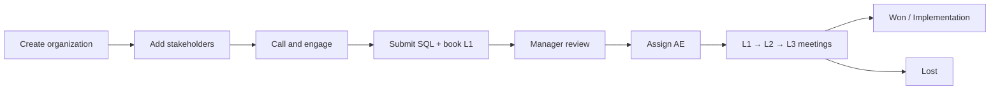
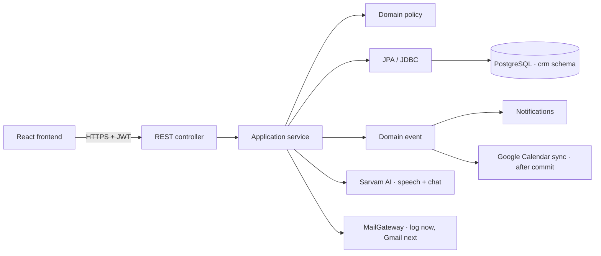
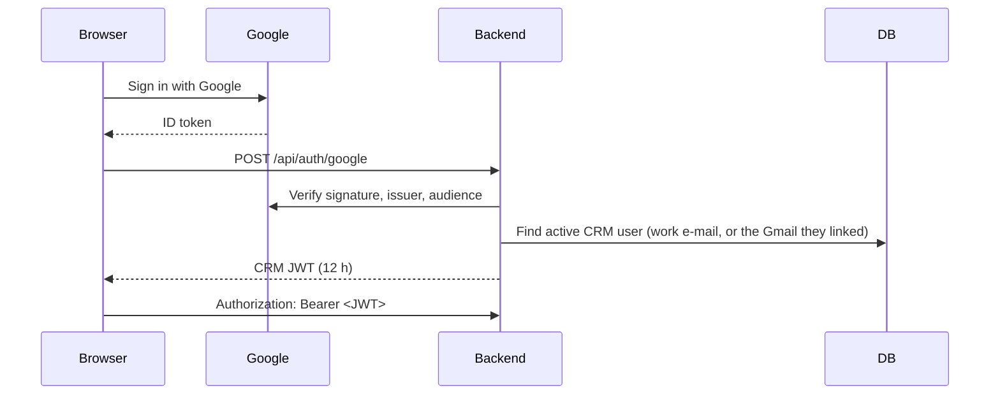
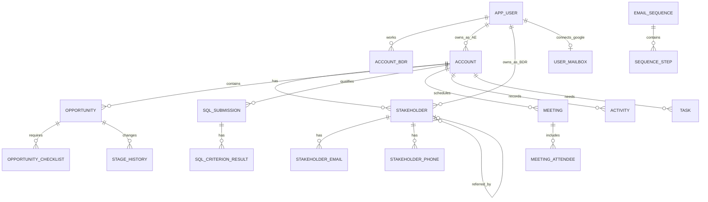
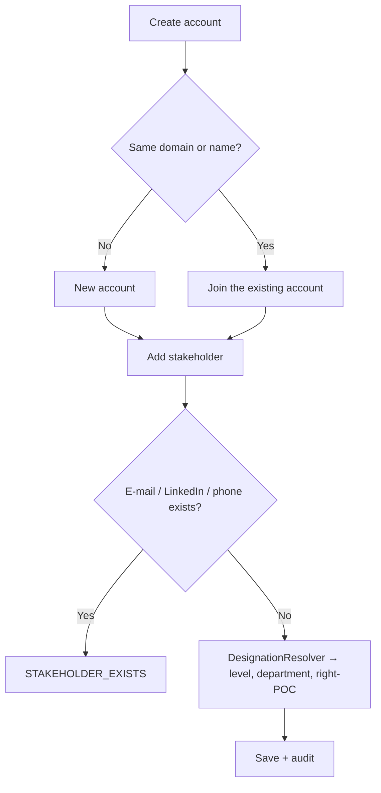
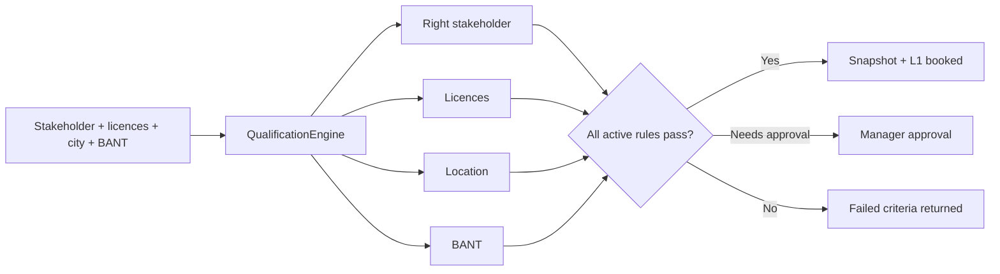
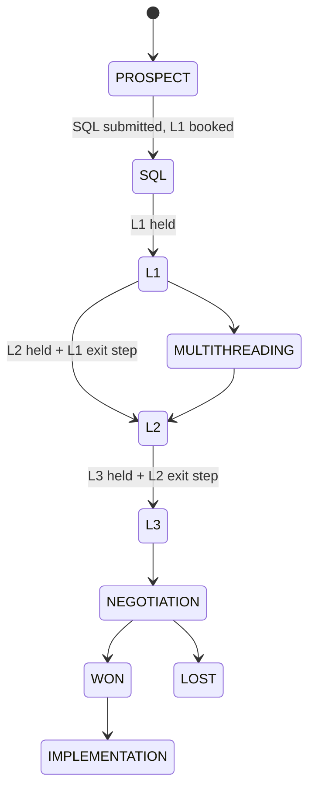

<div align="center">

# Prosperr Sales CRM · Backend

**The API behind Prosperr's B2B sales team: from the first cold call to a signed deal.**

Java 21 · Spring Boot 3.4 · PostgreSQL (Supabase) · Flyway · Spring Security (JWT) · Spring Modulith

[Quick start](#-quick-start) · [What it does](#-what-it-does) · [Architecture](#-architecture) · [Data](#-data-model) · [API](#-api) · [Testing](#-testing) · [Deploying](#-deploying) · [Troubleshooting](#-troubleshooting)

</div>

---

## ⚡ Quick start

**You need:** Java 21, Maven 3.9+, PostgreSQL 15+ (local) or a Supabase database.

```bash
# 1. Create a local database (once)
createdb prosperr_crm

# 2. Run the API on http://localhost:8081 with the local profile
cd prosperr-crm-backend
mvn spring-boot:run -Dspring-boot.run.profiles=local \
  -Dspring-boot.run.arguments="--spring.datasource.username=$USER --spring.datasource.password=local"
```

Flyway creates the `crm` schema and seed data on first start. Then:

| What | Where |
|---|---|
| Health check | http://localhost:8081/actuator/health |
| API explorer (Swagger) | http://localhost:8081/swagger-ui.html |
| Sign in without Google (local only) | `POST /api/auth/dev-login` with `{"email": "<a user's email>"}` |

**First admin.** There is no public sign-up: every person is created by an admin. On an empty database, add the first one by hand:

```sql
INSERT INTO crm.app_user (email, full_name, role) VALUES ('founder@prosperr.io', 'Founder', 'ADMIN');
```

**Optional features** switch on when their keys exist. Put them in a git-ignored `prosperr-crm-backend/.env` (see [`.env.example`](prosperr-crm-backend/.env.example)); the app reads it automatically.

---

## 🎯 What it does

Prosperr CRM turns the Dashboard BRD and the consolidated PRD v1 into enforced business rules.



### Who uses it

| Role | Day to day |
|---|---|
| **BDR** | Creates accounts, finds stakeholders, calls from *My Day*, logs outcomes, submits SQLs with the L1 booked |
| **AE** | Owns qualified accounts, runs L1/L2/L3 meetings, works the deal checklist, moves Negotiation → Won/Lost |
| **Manager** | Reviews SQLs, assigns AEs (with a capacity recommendation), watches the team and pipeline |
| **Admin** | Creates people and roles, edits dropdowns, cities, ICP rules, thresholds and the designation map |

### Feature map

| Area | What's in it | Status |
|---|---|---|
| Accounts & stakeholders | De-duplication by domain/name and email/LinkedIn/phone; designation → level & department | ✅ |
| Prospecting | *My Day* calling queue, 17 call outcomes with automatic follow-up tasks | ✅ |
| SQL qualification | ICP checks (right stakeholder, licences, location, BANT), immutable submission snapshot | ✅ |
| Assignment | Manager queue, least-loaded AE recommendation, reason required to override | ✅ |
| Pipeline | Meetings, stage checklists with exit steps and attachments, stage history | ✅ |
| Lifecycle | Inactive / revisit / reactivation; parking or losing a deal cancels its upcoming meetings | ✅ |
| Reporting | BDR, AE, leadership and hygiene dashboards, 7 operational reports, targets | ✅ |
| Import | CSV/XLSX with column mapping, dry-run preview and guarded commit | ✅ |
| **AI form fill** (Sarvam) | Voice notes or pasted text in 22 Indian languages fill the call log, meeting outcome, stakeholder and SQL BANT forms | ✅ |
| **Google Calendar** | Per-user *Connect Google*; meetings get a Calendar event + Meet link, reschedules move it, cancellations remove it, free/busy lookup | ✅ |
| Gmail sequences | `MailGateway` port exists; Gmail adapter (send, reply/bounce detection) is next | 🔜 |
| Apollo | Planned behind the import/contact-source port | 🔜 |

### Rules the system guarantees

- One BDR owns a stakeholder; several BDRs may work the same account.
- No silent overwrites: a stale edit gets `409 EDIT_CONFLICT`.
- The BDR's SQL snapshot is kept when an AE corrects it.
- Prospecting activity stays private until the account reaches the pipeline.
- Pipeline accounts are never hard-deleted; *inactive* is a status.
- Stages only move by policy (meeting outcomes and exit steps); closed stages are protected.
- A manager, not the system, makes the final AE assignment.
- AI only **suggests**: it pre-fills forms, never saves, and never sees phone numbers or e-mails.

---

## 🏗 Architecture

A **modular monolith**: one deployable app, with module boundaries enforced by [`ModularityTest`](prosperr-crm-backend/src/test/java/com/prosperr/crm/ModularityTest.java) (it fails the build on a cycle or on reaching into another module's internals).



### Modules

```text
com.prosperr.crm
├── shared          Shared kernel: actors, roles, access policy, errors, JDBC helpers, exports
├── identity        Users, Google sign-in, CRM JWT, live token re-validation
├── config          Dropdowns, settings, cities, size buckets, ICP rules, thresholds
├── audit           Field-level audit log
├── account         Organizations and stakeholders
├── prospecting     Calls, outcomes, activities, tasks, My Day
├── qualification   ICP engine, SQL submission and corrections
├── assignment      Manager queue, AE capacity, assignment history
├── pipeline        Meetings, opportunities, stages, checklists
├── lifecycle       Inactivity, revisit and reactivation
├── outreach        Templates, sequences, unsubscribe, MailGateway
├── notification    Event-driven and scheduled in-app notifications
├── reporting       Dashboards, reports, targets (read models)
├── importer        CSV/XLSX parsing, mapping, preview, commit
├── ai              Sarvam speech-to-text and form-fill suggestions
└── integrations    Per-user Google connection and Calendar sync
```

Inside each module:

| Package | Holds |
|---|---|
| `api/` | The module's public interface and domain events: the only thing other modules may use |
| `application/` | Use cases, orchestration, transactions |
| `domain/` | Framework-free business rules (`QualificationEngine`, `StagePolicy`, `OutcomePlanner`, …) |
| `infrastructure/` | JPA entities, repositories, external adapters |
| `web/` | REST controllers: HTTP concerns only |

Modules talk through `api` facades (`AccountApi`, `PipelineApi`, `TaskApi`, `ConfigApi`, `UserDirectory`, …) and domain events (`SqlSubmitted`, `AccountAssigned`, `MeetingBooked`, `MeetingsCancelled`, …), and refer to each other's records by UUID, never by JPA relationships.

### Design patterns in use

| Pattern | Where |
|---|---|
| Strategy / Specification | ICP criteria combined by `QualificationEngine`; `AllocationStrategy` for AE load |
| State / Policy | `StagePolicy` decides valid pipeline moves |
| Rule table | Call outcomes, thresholds, ICP rules live in the database, editable by admins |
| Observer | Domain events drive notifications and Calendar sync |
| Ports & adapters | `MailGateway`, `GoogleTokenVerifier`, `SarvamClient` |
| Optimistic / pessimistic locking | JPA `@Version` → 409; `FOR UPDATE` for AE capacity and import commits |
| Snapshot | SQL submission kept unchanged after corrections |

---

## 🔐 Security



- **Identity** comes from Google; **permissions** come from the CRM (`app_user.role`, ownership, prospecting/pipeline zone, admin field permissions).
- **Linked Gmail sign-in.** A user may sign in with the Google account they linked via *Connect Google*. Linking needs an existing session, so only admin-created users get in.
- **Revocation is live.** Every request re-checks the user is still active and has the same role, so a deactivation or role change takes effect within ~15 s, not when the 12-hour token expires.
- **Lock-out guards.** Admins can't deactivate themselves or remove the last active admin.
- **Record-level checks** in `AccessPolicy` / `AccountGuard`: e.g. a BDR can't move a pipeline account to inactive; only the owning AE or leadership can record outcomes.
- **Google tokens** are stored AES-256-GCM encrypted (`ENCRYPTION_KEY`); the OAuth `state` is HMAC-signed; `/api/integrations/google/callback` is the only unauthenticated route besides login, health and Swagger.
- `DEV_LOGIN_ENABLED` lets anyone sign in with just an e-mail. Keep it **off in production** once Google sign-in works.

---

## 🗄 Data model

Everything lives in the PostgreSQL schema `crm`, managed by Flyway.

| Migration | Adds |
|---|---|
| `V1__init.sql` | Schema (42 tables), triggers, views, seed dropdowns and rules |
| `V2__login_views_seed.sql` | Login fields, saved views, designation data, e-mail templates |
| `V3__designation_dropdown_seed.sql` | Exact designations used by the stakeholder dropdown |
| `V4__google_integration.sql` | Google connection status/scopes; which calendar holds each meeting |

> **Adding a migration?** Use the next free number (`ls prosperr-crm-backend/src/main/resources/db/migration`). Two files with the same version stop the app from starting. Pull first if someone else might have added one.

### Tables by area

| Area | Tables |
|---|---|
| Identity & config | `app_user`, `role_field_permission`, `user_mailbox`, `app_setting`, `picklist_value`, `city`, `size_bucket`, `designation_map`, `icp_rule`, `call_outcome_rule`, `stage_threshold`, `stage_checklist_item` |
| Accounts | `account`, `account_bdr`, `stakeholder`, `stakeholder_email`, `stakeholder_phone` |
| Qualification | `sql_submission`, `sql_criterion_result`, `qualification_correction` |
| Pipeline | `opportunity`, `meeting`, `meeting_attendee`, `attachment`, `opportunity_checklist` |
| Prospecting | `activity`, `task` |
| Outreach | `email_template`, `email_snippet`, `email_sequence`, `sequence_step`, `sequence_enrollment`, `email_message` |
| History & audit | `assignment_history`, `stage_history`, `account_status_history`, `temperature_history`, `audit_log` |
| Operations | `target`, `notification`, `saved_view`, `import_job`, `import_row` |

<details>
<summary><b>Simplified ER diagram</b></summary>


</details>

**Conventions:** UUID keys · `timestamptz` everywhere, displayed in IST · money as `numeric(14,2)` · fixed values as `CHECK` constraints, admin-editable lists in `picklist_value` · triggers keep `account.lifecycle_stage`, size bucket, stage history and last-activity in step.

---

## 🔄 Key flows

<details open>
<summary><b>Add an account and a stakeholder</b></summary>



Unmapped titles are kept as text and listed under *Settings → Designations → Needs mapping*. The SQL "right stakeholder" check reads the stakeholder's level.
</details>

<details>
<summary><b>SQL qualification</b></summary>


</details>

<details>
<summary><b>Pipeline stages</b></summary>



Outcomes can only be recorded once a meeting has started. A combined L1+L2 meeting counts once at each level. Moving an account to Inactive or a deal to Lost cancels its upcoming meetings (and their Calendar events).
</details>

<details>
<summary><b>AI form fill</b></summary>

1. The browser records up to 30 s (or the user uploads a voice note of up to 2 min) and converts it to 16 kHz WAV.
2. `SarvamClient` transcribes it (`saaras:v3`, 22 Indian languages + English); longer audio is split into 25 s pieces.
3. Phone numbers and e-mails are redacted, then `sarvam-105b` returns JSON for the form.
4. Every value is checked against the allowed outcomes, BANT codes, departments and a valid future date before it reaches the UI. Nothing is saved.

Limits: 60 requests per user per hour. Endpoints: `POST /api/ai/call-note`, `POST /api/ai/fill/{MEETING|STAKEHOLDER|SQL}`.
</details>

<details>
<summary><b>Google Calendar</b></summary>

1. *Connect Google* → OAuth consent (Calendar + Gmail scopes, offline access) → `/api/integrations/google/callback` stores the encrypted refresh token.
2. After a booking commits, `CalendarService` creates the event on the booker's (or AE's) calendar with a Meet link. It runs on a background thread, so Google can never block or undo a booking.
3. A reschedule moves the same event; assigning an AE adds them; cancelling removes it.
4. Clients are invited only when `GOOGLE_CALENDAR_INVITE_CLIENTS=true`.
</details>

---

## 🔌 API

Base URL `http://localhost:8081` locally. All routes except login, health, Swagger and the Google callback need `Authorization: Bearer <JWT>`. Full reference: **Swagger UI** at `/swagger-ui.html`.

| Area | Main routes |
|---|---|
| Auth | `POST /api/auth/google`, `POST /api/auth/dev-login`, `GET /api/auth/me` |
| Accounts | `/api/accounts`, `/api/accounts/{id}`, `/api/search`, `/api/saved-views` |
| Stakeholders | `/api/accounts/{id}/stakeholders`, `/api/stakeholders/{id}` |
| Calling | `/api/my-day`, `/api/stakeholders/{id}/calls/preview`, `/api/stakeholders/{id}/calls` |
| SQL | `/api/accounts/{id}/sql/checklist`, `/api/accounts/{id}/sql`, `/api/sql/{id}/validate` |
| Assignment | `/api/assignment/queue`, `/api/assignment/capacity`, `/api/accounts/{id}/assign` |
| Pipeline | `/api/accounts/{id}/meetings`, `/api/meetings/{id}/outcome`, `/api/meetings/{id}/reschedule`, `/api/opportunities/{id}` |
| Lifecycle | `/api/accounts/{id}/inactive`, `/api/accounts/{id}/reactivate` |
| Reporting | `/api/dashboards/*`, `/api/reports/*`, `/api/targets` |
| AI | `/api/ai/status`, `/api/ai/call-note`, `/api/ai/fill/{form}` |
| Google | `/api/integrations/google` (status, connect, disconnect), `/api/integrations/google/busy` |
| Admin | `/api/admin/users`, `/api/admin/designations`, `/api/config/*` |
| Import | `/api/imports`, `/api/imports/{id}/rows`, `/api/imports/{id}/commit` |
| Notifications | `/api/notifications` |

**Errors** are RFC 7807 `ProblemDetail` with a machine-readable `code`:

```json
{ "status": 422, "title": "Unprocessable Entity", "code": "STAKEHOLDER_EXISTS",
  "detail": "A stakeholder with this email already exists" }
```

| Status | Meaning |
|---|---|
| 401 | No or invalid token, or the user was deactivated / changed role |
| 403 | Signed in but not allowed (role or ownership) |
| 409 | `EDIT_CONFLICT`: someone saved this record first |
| 422 | A business rule failed; `code` says which (e.g. `MEETING_NOT_STARTED`, `IMPORT_NOT_READY`, `LAST_ADMIN`) |

---

## 🧪 Testing

143 tests: domain unit tests, access-policy tests, HTTP integration tests with real JWTs, AI and Calendar guardrails, and the module-boundary check.

```bash
cd prosperr-crm-backend

# With Docker running: Testcontainers starts a throwaway PostgreSQL
mvn test

# Without Docker: point the tests at a local database (it is reset by the tests)
createdb crm_test
CRM_TEST_DB_URL='jdbc:postgresql://localhost:5432/crm_test?currentSchema=crm' \
CRM_TEST_DB_USER=$USER CRM_TEST_DB_PASSWORD=local mvn test
```

If a run fails on leftover data, reset the test schema first: `psql -d crm_test -c "DROP SCHEMA IF EXISTS crm CASCADE;"`.

---

## 🚀 Deploying

The API runs on **Render** from [`prosperr-crm-backend/Dockerfile`](prosperr-crm-backend/Dockerfile) (multi-stage build, heap tuned for 512 MB). The frontend on **Vercel** forwards `/api/*` to Render.

### Environment variables

| Variable | Required | Purpose |
|---|---|---|
| `DB_URL`, `DB_USERNAME`, `DB_PASSWORD` | ✅ | PostgreSQL / Supabase connection |
| `JWT_SECRET` | ✅ | Signs CRM tokens, ≥ 32 bytes (`openssl rand -hex 32`) |
| `FRONTEND_URL` | ✅ | The Vercel site: CORS and where Google sends users back |
| `APP_BASE_URL` | ✅ | Public backend URL |
| `GOOGLE_CLIENT_ID` | for Google sign-in | OAuth client ID used to verify sign-in tokens |
| `DEV_LOGIN_ENABLED` | | `true` allows e-mail-only sign-in (local/demo only) |
| `JOBS_ENABLED` | | Scheduled jobs (default on; run them on one instance) |
| `SARVAM_API_KEY` | for AI | Voice notes and AI form fill; blank turns AI off |
| `GOOGLE_OAUTH_CLIENT_ID`, `GOOGLE_OAUTH_CLIENT_SECRET` | for Calendar | Per-user *Connect Google* |
| `GOOGLE_OAUTH_REDIRECT_URI` | for Calendar | `https://<backend>/api/integrations/google/callback` (also listed on the OAuth client) |
| `ENCRYPTION_KEY` | for Calendar | 64 hex chars; encrypts stored Google tokens. **Never change it once people have connected** |
| `GOOGLE_CALENDAR_INVITE_CLIENTS` | | `true` to invite client stakeholders to Calendar events (default `false`) |
| `MAIL_PROVIDER` | | `log` today; `gmail` once the adapter ships |

**Google Cloud:** add the Vercel site under *Authorised JavaScript origins*, the callback above under *Authorised redirect URIs*, and every user's Gmail under *Audience → Test users* while the app is in testing mode.

> Never commit secrets. `application-local.yml` reads them from the environment, and `.env` is git-ignored. If a secret is ever pushed or pasted somewhere public, rotate it.

---

## 🩺 Troubleshooting

| Symptom | Likely cause |
|---|---|
| App won't start: *"Found more than one migration with version N"* | Two migrations share a number. Renumber yours to the next free version |
| `401` right after a user's role or status changed | Expected: their old token is rejected. They sign in again |
| "Continue with Google" greyed out | The frontend has no `VITE_GOOGLE_CLIENT_ID` (set it in Vercel and redeploy) |
| Google says *"no registered origin"* | The site isn't under *Authorised JavaScript origins* on the OAuth client |
| *"No CRM access for x@gmail.com"* | That Gmail isn't linked: sign in with the work e-mail and use *Connect Google* once |
| AI or Calendar buttons missing | `SARVAM_API_KEY` or the Google OAuth variables aren't set on the server |
| First request after a while times out | Render's free plan sleeps; it wakes in 1–2 minutes |
| SQL fails *"Designation is not mapped to a level"* | Map the title in *Settings → Designations* |
