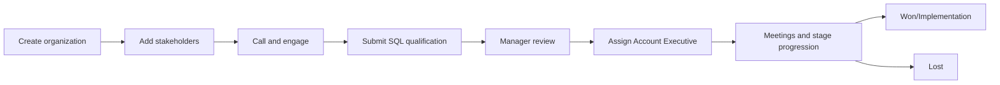
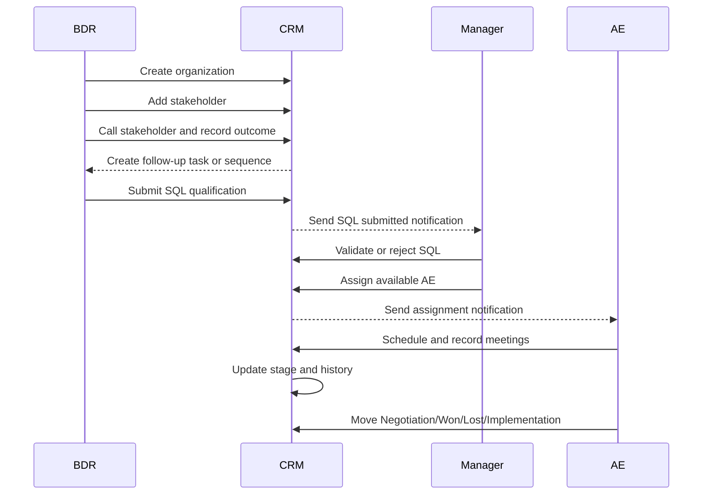
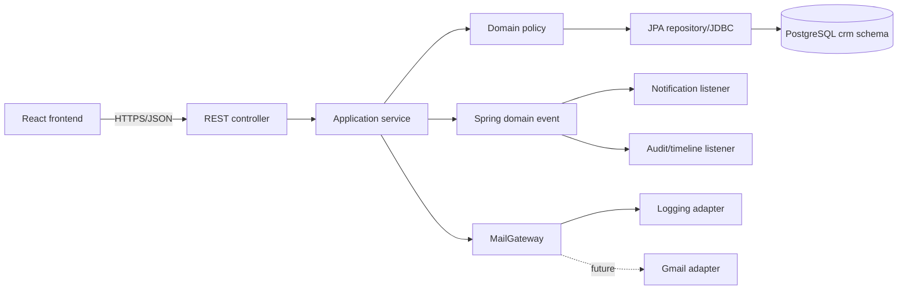
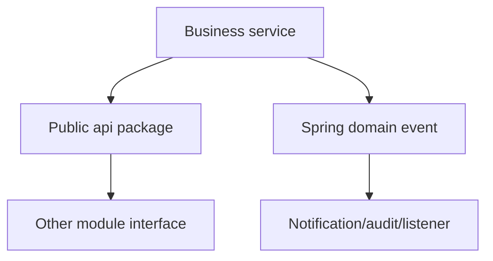
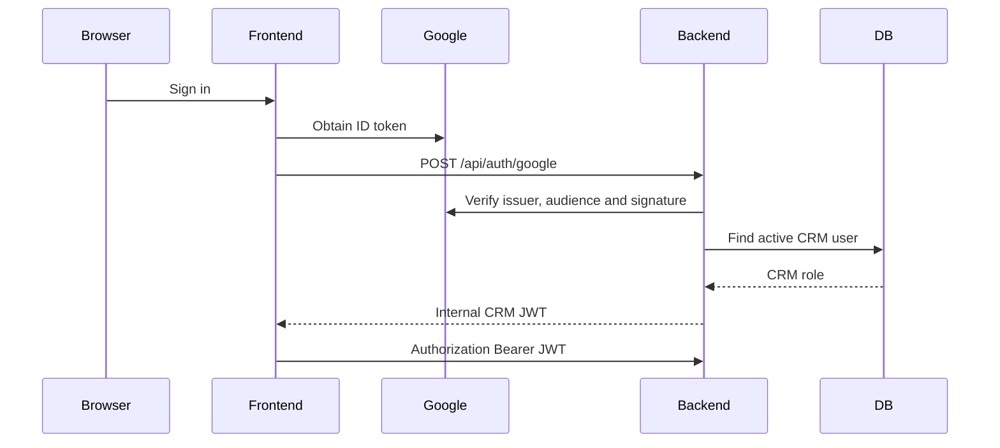
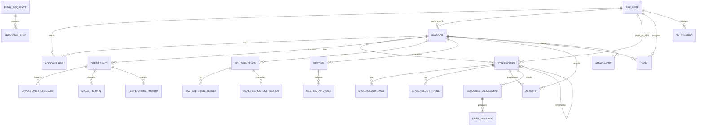
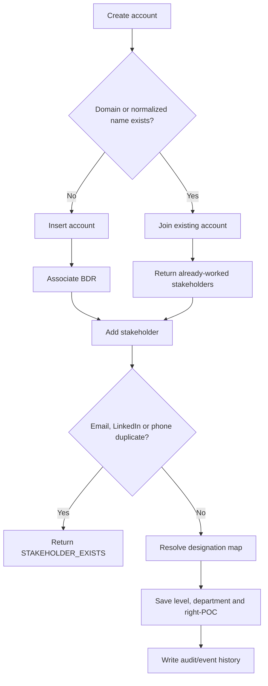
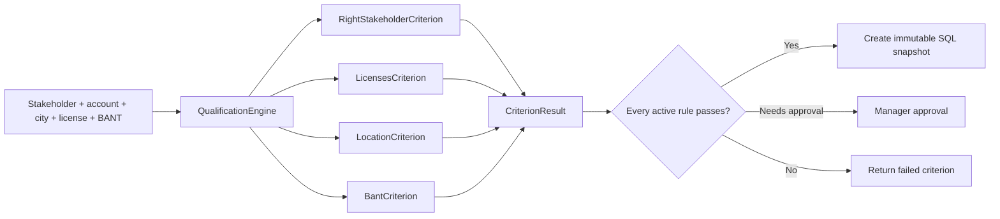
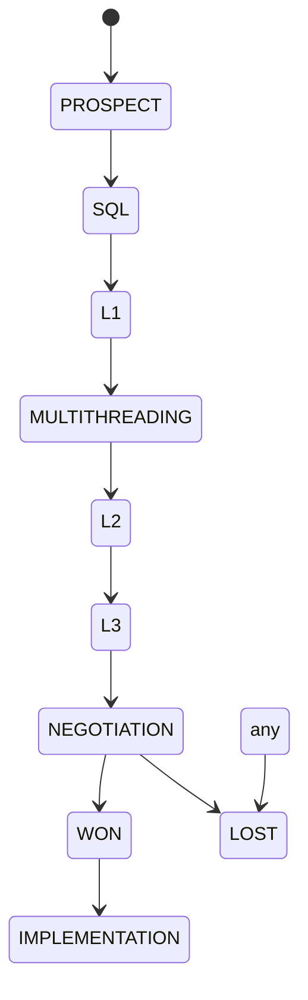

# Prosperr Sales CRM - Backend

Spring Boot 3.4, Java 21, PostgreSQL/Supabase, Flyway, Spring Security, JWT, Spring Modulith.

## 1. Business perspective

### What this system does

Prosperr CRM is a sales operating system for the complete B2B revenue workflow:



The implementation turns the Dashboard BRD and Consolidated PRD v1 into executable business rules. The business areas are:

| Area | Purpose |
|---|---|
| Accounts | Maintain organizations, owners, status, size, city, industry and lifecycle |
| Stakeholders | Maintain people, roles, seniority, department, contact data and engagement |
| Prospecting | Rank calls, record outcomes, create follow-up tasks and run the My Day queue |
| SQL | Qualify an account using stakeholder, licenses, location and BANT criteria |
| Assignment | Put qualified SQLs in a manager queue and recommend a least-loaded AE |
| Meetings | Schedule L1/L2/L3 meetings and record outcomes |
| Pipeline | Move opportunities through SQL, L1, L2, L3, Negotiation, Won/Lost/Implementation |
| Lifecycle | Detect inactive accounts and manage revisit, revival and reactivation |
| Outreach | Run email sequences, templates, merge fields, send windows and stop rules |
| Reporting | Produce BDR, AE, leadership, hygiene dashboards and operational reports |
| Administration | Maintain users, roles, picklists, cities, thresholds and designation mappings |
| Importing | Upload CSV/XLSX data and preview duplicates before committing |

### Main roles

| Role | Main responsibilities |
|---|---|
| BDR | Create accounts, find and contact stakeholders, record calls, submit SQL |
| AE | Own qualified accounts, conduct meetings, maintain opportunity, move pipeline |
| Manager | Review SQL, assign or reassign AE, set targets, monitor team and pipeline |
| Admin | Manage users, role permissions and configurable CRM rules |

### End-to-end user flow



### Business invariants

- One BDR owns a stakeholder, while several BDRs may work on the same account.
- A second person must not silently overwrite another person's edit.
- The original BDR SQL snapshot is retained if an AE makes corrections.
- Prospecting activity is private to relevant BDR and leadership until pipeline rules allow history visibility.
- A pipeline account is not hard-deleted; inactive is a status.
- A stage moves backwards automatically only within policy rules; closed stages are protected.
- A duplicate account is joined by normalized name/domain instead of creating another organization.
- A duplicate stakeholder is blocked by normalized email, LinkedIn or phone where applicable.
- Required exit steps and attachments control stage completion.
- A manager, not the system, makes the final AE assignment.

### Current implementation status

- Core modules and REST APIs are implemented.
- Gmail OAuth/API adapter is still a future integration.
- Google Calendar integration is not implemented.
- Generic CSV/XLSX import is implemented; workbook-specific migration rules require source workbooks.
- Apollo integration is planned, not directly implemented.

---

## 2. Engineering perspective

### Technology

- Java 21
- Spring Boot 3.4
- Spring Web MVC
- Spring Security + OAuth2 resource server
- Spring Data JPA
- NamedParameterJdbcTemplate
- PostgreSQL
- Flyway
- Spring Modulith
- Testcontainers
- Swagger/OpenAPI

### Runtime architecture



### Application startup

[CrmApplication.java](src/main/java/com/prosperr/crm/CrmApplication.java) starts the Spring application.

Spring performs:

1. Package/component scanning.
2. Dependency injection and bean creation.
3. Configuration-property binding.
4. Datasource configuration.
5. Flyway migration before normal startup is considered complete.
6. JPA/Hibernate setup.
7. Spring Security setup.
8. Scheduled job registration.
9. HTTP server startup.

Key Spring concepts:

- `@SpringBootApplication`: configuration, auto-configuration and component scanning.
- `@Configuration`: declares framework configuration and beans.
- `@Bean`: creates a managed object.
- `@Component`, `@Service`, `@Repository`: roles for Spring-managed classes.
- Constructor injection: dependencies are explicit and easier to test.
- `@ConfigurationProperties`: binds application YAML/environment variables.

---

## 3. Module architecture

This is a modular monolith: one deployable process with enforced business-module boundaries.

```text
com.prosperr.crm
├── shared          Shared kernel: actors, roles, access, errors, JDBC, exports
├── identity        Users, Google sign-in, CRM JWT, active-user validation
├── config          Picklists, settings, cities, buckets, ICP, thresholds
├── audit           Field-level audit log
├── account         Organization/stakeholder aggregate and account queries
├── prospecting     Calls, outcomes, activities, tasks and My Day
├── qualification   ICP engine, SQL submission and corrections
├── assignment      Manager queue, AE capacity and assignment history
├── pipeline        Meetings, opportunities, stage and checklist state
├── lifecycle       Inactivity, reactivation and revisit rules
├── outreach        Mail gateway, templates, sequences and unsubscribe
├── notification    Scheduled and event-driven in-app notifications
├── reporting       Dashboard/read-model queries, reports and targets
└── importer        CSV/XLSX parsing, mapping, preview and commit
```

Each module follows:

```text
api/             Public module interface and domain events
application/     Use cases, orchestration and transactions
domain/          Framework-independent business rules
infrastructure/ JPA entities, repository implementations and adapters
web/             REST controllers
```

Module boundaries are verified by [ModularityTest.java](src/test/java/com/prosperr/crm/ModularityTest.java). It fails the build for dependency cycles or reaching into another module's internals.

### Cross-module communication



Examples:

- `AccountApi`
- `StakeholderApi`
- `PipelineApi`
- `TaskApi`
- `ActivityApi`
- `ConfigApi`
- `AuditApi`
- `UserDirectory`

The modules communicate by UUID references rather than JPA entity relationships across package boundaries.

---

## 4. Layer conventions

### Controller

A controller owns HTTP concerns:

- URL and HTTP method
- Request DTO deserialization
- Current-user lookup
- Response status
- No detailed business policy

Example: [StakeholderController.java](src/main/java/com/prosperr/crm/account/web/StakeholderController.java).

### Application service

An application service coordinates a use case:

1. Receive a command.
2. Read required entities.
3. Check authorization.
4. Call domain rules.
5. Persist data.
6. Publish events/audit records.
7. Return a view DTO.

Example: [StakeholderService.java](src/main/java/com/prosperr/crm/account/application/StakeholderService.java).

### Domain

Domain classes contain framework-independent rules:

- `QualificationEngine`
- `IcpCriterion`
- `StagePolicy`
- `InactivityPolicy`
- `AllocationStrategy`
- `OutcomePlanner`
- `SendWindow`

### Infrastructure

Infrastructure adapts Java code to technical systems:

- JPA entities
- Spring Data repositories
- JDBC queries
- PostgreSQL views/triggers
- Google verifier
- Log mail gateway

### Transactions

`@Transactional` wraps multiple database operations as one unit:

- Commit everything together when successful.
- Roll back everything when a runtime exception occurs.

Reporting services use `@Transactional(readOnly = true)` to communicate intent and improve read behavior.

---

## 5. Authentication and authorization

### Authentication flow



Google authentication establishes identity. Authorization uses:

- CRM `app_user.role`
- CRM active status
- Allowed company domain
- Account ownership
- Prospecting/pipeline zone
- Admin-managed field permissions

### Security configuration

[SecurityConfig.java](src/main/java/com/prosperr/crm/identity/infrastructure/SecurityConfig.java) configures:

- Stateless sessions
- CSRF disabled for stateless bearer-token API
- Public login, health and Swagger routes
- JWT authentication for all other routes
- CORS for the configured frontend origin
- Role conversion from the JWT `role` claim

`@PreAuthorize` performs method-level role checks.

`AccessPolicy` performs record-level decisions. For example:

- BDR can work a prospecting account only when associated with that account.
- AE can edit pipeline opportunities only on owned accounts.
- Manager/Admin can assign or review.
- Prospecting activity may be hidden from another BDR.

[CurrentUser.java](src/main/java/com/prosperr/crm/shared/security/CurrentUser.java) reads the signed-in actor from the JWT subject and role.

---

## 6. Database design

The system uses PostgreSQL and stores everything in the `crm` schema.

Flyway migrations:

- `V1__init.sql`: initial 42-table schema and seed data
- `V2__login_views_seed.sql`: login fields, saved views, views, designation data and templates
- `V3__designation_dropdown_seed.sql`: exact stakeholder designation dropdown mappings

### Database groups

| Group | Tables |
|---|---|
| Identity/configuration | `app_user`, `role_field_permission`, `user_mailbox`, `app_setting`, `picklist_value`, `city`, `size_bucket`, `designation_map`, `icp_rule`, `call_outcome_rule`, `stage_threshold`, `stage_checklist_item` |
| Accounts | `account`, `account_bdr`, `stakeholder`, `stakeholder_email`, `stakeholder_phone` |
| Qualification | `sql_submission`, `sql_criterion_result`, `qualification_correction` |
| Pipeline | `opportunity`, `meeting`, `meeting_attendee`, `attachment`, `opportunity_checklist` |
| Prospecting | `activity`, `task` |
| Outreach | `email_template`, `email_snippet`, `email_sequence`, `sequence_step`, `sequence_enrollment`, `email_message` |
| History/audit | `assignment_history`, `stage_history`, `account_status_history`, `temperature_history`, `audit_log` |
| Operations | `target`, `notification`, `saved_view`, `import_job`, `import_row` |

### Entity-purpose reference

| Entity | Function |
|---|---|
| `app_user` | Authenticated CRM person, role and manager relationship |
| `role_field_permission` | Admin-managed field/action override |
| `user_mailbox` | BDR mailbox address and send throttling |
| `app_setting` | Configurable key/value rules |
| `picklist_value` | Industry, sources, reasons, outcomes and BANT values |
| `city` | City and P0/P1/NONE ICP priority |
| `size_bucket` | License ranges for Small/Medium/Large/Enterprise |
| `designation_map` | Title to L1-L5, department and calling priority |
| `icp_rule` | Configuration for a qualification criterion |
| `call_outcome_rule` | Call outcome behavior and follow-up task rule |
| `stage_threshold` | Inactivity/stagnation/follow-up thresholds |
| `stage_checklist_item` | Checklist requirements by pipeline stage |
| `account` | Organization, lifecycle, status, owner and next step |
| `account_bdr` | Many-to-many relationship between account and BDR |
| `stakeholder` | Person, title, designation map, level, role and engagement |
| `stakeholder_email` | One or many emails for a stakeholder |
| `stakeholder_phone` | One or many phones and validity/WhatsApp status |
| `opportunity` | Commercial pipeline record, stage, MRR and temperature |
| `sql_submission` | Immutable snapshot of BDR SQL qualification |
| `sql_criterion_result` | Pass/fail/detail for every submitted ICP criterion |
| `qualification_correction` | AE correction without erasing BDR original |
| `meeting` | L1/L2/L3 meeting booking and outcome |
| `meeting_attendee` | Stakeholder participation in a meeting |
| `attachment` | Evidence for stage checklist or meeting |
| `opportunity_checklist` | Completed stage requirements |
| `email_template` | Subject/body template |
| `email_snippet` | Department-specific reusable email block |
| `email_sequence` | Sequence definition |
| `sequence_step` | Template and day offset in a sequence |
| `sequence_enrollment` | One stakeholder currently enrolled in a sequence |
| `email_message` | Sent email/provider thread audit |
| `activity` | Calls, emails and notes in stakeholder timeline |
| `task` | User work item with due date/status |
| `assignment_history` | AE or BDR reassignment audit |
| `stage_history` | Every opportunity stage transition |
| `account_status_history` | Active/inactive/reactivation history |
| `temperature_history` | Hot/Warm/Cold change history |
| `audit_log` | Generic field/entity audit |
| `target` | User performance target |
| `notification` | In-app notification |
| `saved_view` | Personal or shared dashboard/account filter |
| `import_job` | CSV/XLSX import and summary status |
| `import_row` | Each import row and duplicate preview result |

### Simplified ER diagram



### Database invariants

- Fixed system values use PostgreSQL `CHECK` constraints.
- Administrative lists use `picklist_value`.
- Every time is stored as `timestamptz`; reporting applies `Asia/Kolkata` for IST display.
- Money uses `numeric(14,2)`.
- UUID is used for identifiers.
- JPA `@Version` protects entities from lost updates.
- Unique indexes prevent duplicate accounts, stakeholder LinkedIn profiles and primary rows.
- Foreign keys preserve referential integrity.
- `ON CONFLICT` handles concurrent account/config/import writes.
- Read views expose recurring operational calculations such as AE capacity and revival queue.

---

## 7. Add-account and add-stakeholder flow



For stakeholder designation:

1. The frontend loads `/api/config/designations`.
2. It sends the exact designation text to `StakeholderService`.
3. `DesignationResolver` normalizes and finds `designation_map`.
4. The stakeholder receives level L1-L5 and department.
5. Unmapped titles remain valid text but are sent to the unmapped review list.
6. The UI dropdown prevents unsupported titles while admins can still map new titles in Settings.

This preserves `DesignationResolver`, duplicate logic and designation-level mapping.

---

## 8. SQL qualification flow



Design patterns:

- **Strategy:** every ICP criterion implements `IcpCriterion`.
- **Specification:** `QualificationEngine` combines active specifications.
- **Rule table:** active rules and parameters come from `icp_rule`.
- **Snapshot:** BDR-submitted values remain unchanged after AE corrections.

---

## 9. Pipeline state flow



`StagePolicy` also enforces:

- Completed L1 + exit step unlocks L2.
- Completed L2 + L1/L2 exit requirements unlock L3.
- A combined L1+L2 meeting completes both levels once.
- Negotiation/Won/Lost/Implementation are controlled by policy/manual actions.
- Stage history records the from/to state and acting user.

---

## 10. Important engineering patterns

| Pattern | Purpose | Example |
|---|---|---|
| Modular Monolith | One deployable system with strict module boundaries | Spring Modulith |
| Package-by-Feature | Organize code by business capability | `account`, `pipeline`, `outreach` |
| Facade | Hide implementation behind module API | `AccountApi`, `PipelineApi` |
| Strategy | Swap rule implementations | `IcpCriterion`, `AllocationStrategy` |
| Specification | Combine pass/fail business rules | `QualificationEngine` |
| State/Policy | Define valid pipeline transitions | `StagePolicy` |
| Rule Table | Move frequently changed values to database | outcomes, thresholds, ICP rules |
| Observer/Domain Event | Publish changes to notification/timeline listeners | `SqlSubmitted`, `AccountAssigned` |
| Ports and Adapters | Replace external integrations | `MailGateway` / logging or Gmail |
| Optimistic Locking | Reject stale edits | JPA `@Version`, HTTP 409 |
| Pessimistic Locking | Claim queue work or reserve concurrent writes | `FOR UPDATE`, `SKIP LOCKED` |
| CQRS-lite | Separate transactional write and SQL reporting read models | services vs dashboard views |
| Soft Delete | Preserve CRM history | inactive/deactivated/stopped records |
| Snapshot | Preserve submitted source-of-truth values | SQL submission and corrections |

---

## 11. REST API conventions

Base URL:

```text
http://localhost:8081
```

Example API areas:

| Area | Representative routes |
|---|---|
| Authentication | `/api/auth/google`, `/api/auth/dev-login`, `/api/auth/me` |
| Accounts | `/api/accounts`, `/api/accounts/{id}`, `/api/search`, `/api/saved-views` |
| Stakeholders | `/api/accounts/{id}/stakeholders`, `/api/stakeholders/{id}` |
| Calling | `/api/my-day`, `/api/stakeholders/{id}/calls/preview`, `/api/stakeholders/{id}/calls` |
| SQL | `/api/accounts/{id}/sql/checklist`, `/api/accounts/{id}/sql`, `/api/sql/{id}/validate` |
| Assignment | `/api/assignment/queue`, `/api/assignment/capacity`, `/api/accounts/{id}/assign` |
| Pipeline | `/api/accounts/{id}/meetings`, `/api/meetings/{id}/outcome`, `/api/opportunities/{id}` |
| Reporting | `/api/dashboards/*`, `/api/reports/*`, `/api/targets` |
| Administration | `/api/admin/users`, `/api/admin/designations`, `/api/config/designations` |
| Import | `/api/imports` |
| Notifications | `/api/notifications` |

Swagger UI:

```text
http://localhost:8081/swagger-ui.html
```

### Error format

Errors use RFC 7807 `ProblemDetail` with a machine-readable `code`, for example:

```json
{
  "type": "about:blank",
  "title": "Unprocessable Entity",
  "status": 422,
  "detail": "A stakeholder with this email already exists",
  "code": "STAKEHOLDER_EXISTS"
}
```

[GlobalExceptionHandler.java](src/main/java/com/prosperr/crm/shared/web/GlobalExceptionHandler.java) maps domain, authorization, not-found, validation and optimistic-lock failures.

---

## 12. Concurrency and data protection

### Optimistic locking

Accounts, stakeholders and opportunities contain JPA `@Version`.

- First writer: succeeds.
- Second writer using stale version: HTTP 409 `EDIT_CONFLICT`.
- No silent overwrite.

### Pessimistic locking

Assignment locks AE rows for a capacity decision.

Sequence processing uses `FOR UPDATE SKIP LOCKED` so only one worker can claim an enrollment.

### Duplicate protection

- Account normalized name/domain uniqueness
- Stakeholder LinkedIn uniqueness
- Stakeholder email uniqueness
- Primary SPOC and primary phone/email constraints
- `ON CONFLICT` for concurrency-safe setup writes

### Auditing and history

The system keeps:

- Field-level audit
- Stage history
- Status history
- Temperature history
- Assignment history
- Qualification correction
- Activity timeline

---

## 13. Scheduled jobs

Scheduled work is feature-flagged with `crm.jobs.enabled`.

Examples:

- Flag stale accounts
- Open revisit queues
- Process sequence steps
- Poll email replies
- Send follow-up reminders
- Notify about meetings without outcome
- Build daily digest notifications

Schedulers use IST zone for CRM business time.

One instance should own jobs in a production deployment until distributed scheduler locking is added.

---

## 14. Testing strategy

```bash
mvn test
```

The test suite includes:

- Domain unit tests
- Access-policy tests
- Spring integration tests
- Real PostgreSQL/JDBC validation
- Testcontainers support
- Spring Modulith architecture tests

Domain tests cover qualification, call outcomes, stage policy, allocation, inactivity, send windows, template rendering and permissions.

Integration tests cover HTTP behavior and end-to-end use cases with JWTs.

Before full Maven verification, migrations and SQL statements must be validated against a real PostgreSQL instance.

---

## 15. Run locally

Prerequisites:

- Java 21
- Maven 3.9+
- PostgreSQL 15+ or Supabase

Environment variables:

| Variable | Purpose |
|---|---|
| `DB_URL` | PostgreSQL JDBC URL |
| `DB_USERNAME` | Database user |
| `DB_PASSWORD` | Database password |
| `JWT_SECRET` | Internal CRM JWT secret, at least 32 bytes |
| `GOOGLE_CLIENT_ID` | Google OAuth web client |
| `FRONTEND_URL` | Allowed React origin |
| `APP_BASE_URL` | Public backend URL |
| `DEV_LOGIN_ENABLED` | Enables local-only dev login |
| `JOBS_ENABLED` | Enables scheduled jobs |
| `MAIL_PROVIDER` | `log` or future `gmail` |

Recommended local command:

```bash
cd Crm_Prosperr_backend/prosperr-crm-backend
mvn spring-boot:run -Dspring-boot.run.arguments="--spring.profiles.active=local"
```

Health:

```text
http://localhost:8081/actuator/health
```

Swagger:

```text
http://localhost:8081/swagger-ui.html
```

First admin:

```sql
INSERT INTO crm.app_user (email, full_name, role)
VALUES ('founder@prosperr.io', 'Founder', 'ADMIN');
```

Admin-created users are the source of user identity and role. There is no public self-sign-up.
